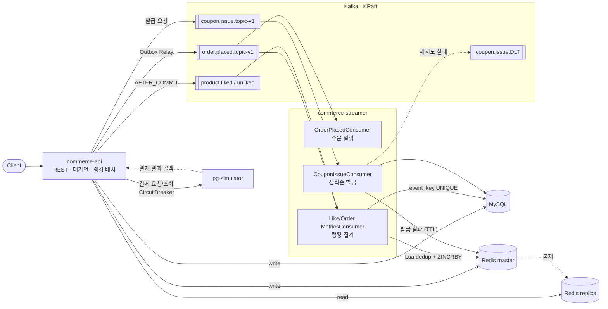
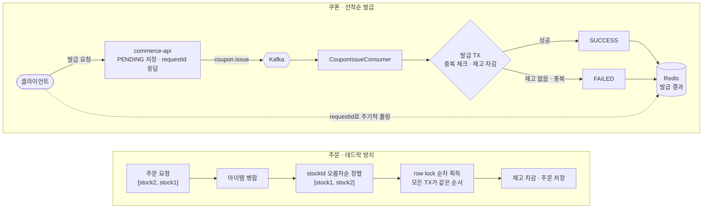
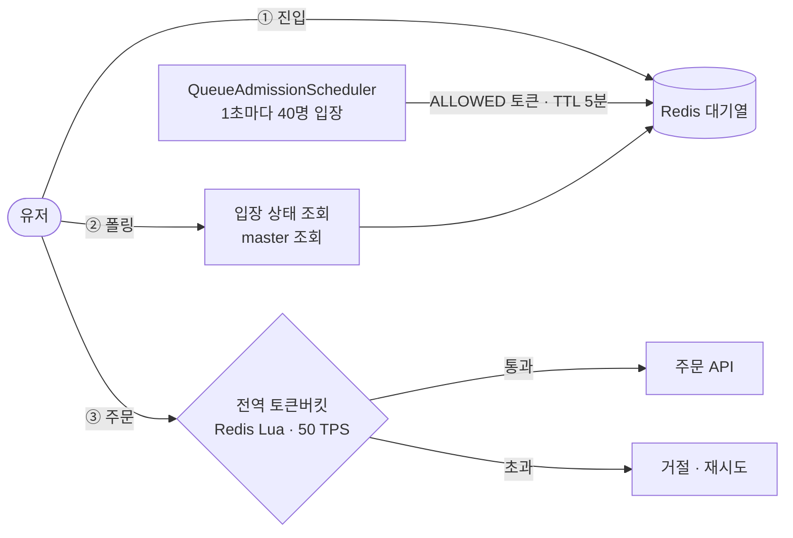
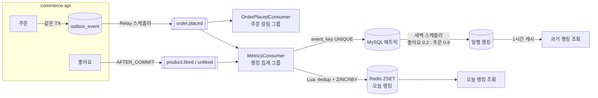
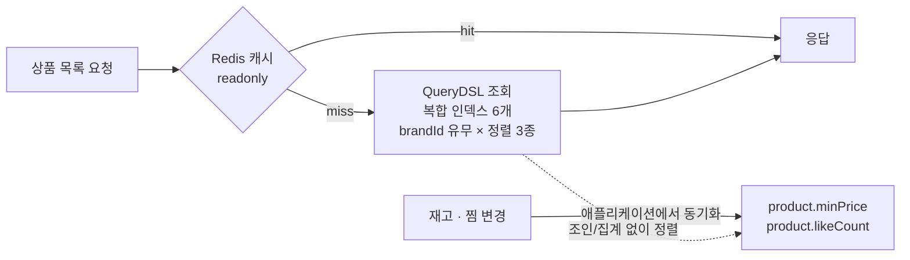
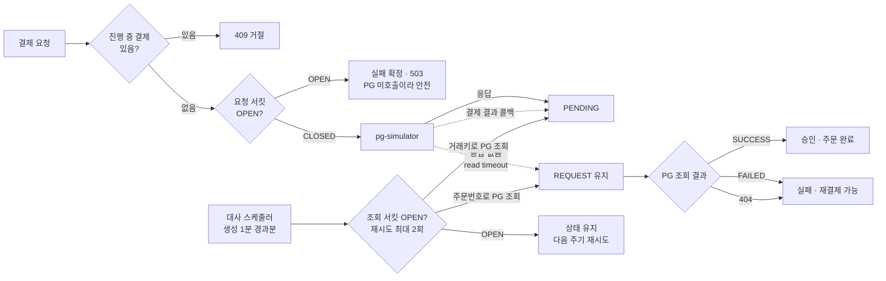

# Loopers Commerce Backend

Loopers 백엔드 부트캠프 10주 과정에서 진행한 이커머스 백엔드 멀티모듈 프로젝트입니다.
동시성 제어, 대규모 트래픽 대응, 이벤트 기반 데이터 정합성까지 단계적으로 확장하며,
문제 재현과 부하테스트 실측으로 운영값을 산정하는 데 중점을 두었습니다.

## 기술 스택

| 구분 | 기술 |
|------|------|
| Language / Framework | Java 21, Spring Boot 3.4 |
| Build | Gradle (Kotlin DSL), 멀티모듈 |
| Persistence | Spring Data JPA, QueryDSL, MySQL 8.0 |
| Cache | Redis (master-replica) |
| Messaging | Kafka (KRaft) |
| Batch | Spring Batch |
| Resilience | Resilience4j |
| Test | JUnit 5, Testcontainers, Instancio, k6 (부하테스트) |

## 모듈 구조

```text
Root
├── apps ( 실행 가능한 Spring Boot 애플리케이션 )
│   ├── 📦 commerce-api        # REST API 서버
│   ├── 📦 commerce-batch      # 배치 처리 (랭킹 집계 등)
│   ├── 📦 commerce-streamer   # Kafka 이벤트 소비/반영 서버
│   └── 📦 pg-simulator        # 결제(PG) 연동 시뮬레이터
├── modules ( 재사용 가능한 인프라 설정 )
│   ├── 📦 jpa
│   ├── 📦 redis
│   └── 📦 kafka
└── supports ( 부가 기능 add-on )
    ├── 📦 jackson
    ├── 📦 monitoring
    ├── 📦 logging
    └── 📦 resilience
```

레이어드 아키텍처(`interfaces → application → domain → infrastructure`)와 DIP를 따르며,
Facade가 여러 도메인 Service를 조합해 유스케이스를 완성하는 구조를 일관되게 적용했습니다.

## 시스템 구조



## 핵심 기능 & 기술적 의사결정

### 1. 선착순 쿠폰 동시성 제어 & 멀티 아이템 주문 데드락 해결



**배경**
- 선착순 쿠폰 오픈 직후 요청이 몰려, 요청마다 DB 재고를 차감하면 락 경합이 DB 부하로 직결되는 문제 존재
- 같은 유저가 N번의 쿠폰 발급 요청으로 여러 건의 쿠폰 중복 발급 위험 존재
- 다중 상품 주문 시 요청 순서대로 row lock을 잡아, 역순 주문끼리 교착 상태 및 간헐적 500 발생

**구현**
- 발급 요청을 Kafka 단일 파티션으로 받아 컨슈머가 한 건씩 재고 차감
- 클라이언트는 requestId로 발급 결과를 주기적으로 폴링
- 컨슈머 처리 시 DB 유니크 제약(user_id, coupon_id)으로 쿠폰 중복 발급 방지
- 주문 항목을 stockId 오름차순으로 사전 정렬해 모든 트랜잭션의 lock 획득 순서 통일

**결과**
- 선착순 쿠폰 오픈 직후 요청이 몰리는 현상 완화
- 재고 100개 쿠폰에 200명 동시 발급 요청 시 정확히 100명만 성공
- 역순 동시 주문에서 발생하던 데드락 해소

**상세: 데드락 원인과 재현**
- **원인**: 여러 재고를 한 번에 주문할 때 `LinkedHashMap`으로 아이템을 병합해, 클라이언트가 보낸 요청 순서가 그대로 row lock 획득 순서가 됨 → 두 트랜잭션이 서로 반대 순서로 lock을 걸면 순환 대기 발생
- **재현**: 홀수 번째 요청은 `[stock1→stock2]`, 짝수 번째 요청은 `[stock2→stock1]` 순서로 동시 주문해 간헐적 500 (MySQL Deadlock) 확인
- **해결**: 병합 결과를 `stockId` 오름차순으로 정렬 후 lock 획득 → 모든 트랜잭션이 항상 같은 순서로 잠그므로 순환 대기 조건 자체가 성립하지 않음

**상세: 쿠폰 1회성 사용**
- 같은 유저가 서로 다른 상품(재고 락이 겹치지 않는 조건)으로 동일 쿠폰을 동시에 5번 사용 시도해도 1건만 성공하도록 검증 (쿠폰 자체의 동시성 제어가 재고 락에 기대지 않고 독립적으로 동작하는지 확인)

### 2. 주문 대기열 & 전역 Rate Limiter (부하테스트 기반 용량 산정)



**배경**
- 블랙프라이데이처럼 주문 트래픽이 순간 폭주하는 가상 시나리오를 설정하고, 서버·DB가 감당 가능한 수준으로 유입을 제어할 구조 필요
- 대기열은 입장 속도만 제어해, 입장 후 주문 몰림은 막지 못함

**구현**
- 대기열은 Redis로 토큰 검증·폴링 API 구현, 스케줄러 batch-size로 입장 속도 조절
- k6 단계별 고정 부하 테스트(RATE 20~80)로 서비스 처리 한계 측정
- 상품 주문 요청 시 Redis Lua 전역 토큰버킷(capacity/refill=50)으로 2단 방어

**결과**
- RATE 50까지 p95 100~140ms로 안정, RATE 60부터 13.9초로 급증해 안전 상한 50 TPS 확인
- 실패율은 전 구간 0.5%대로 일정해 지연시간을 용량 경계 지표로 판단, 10 TPS 마진을 두고 batch-size=40 확정하여 2단 제어의 기준값 산정

**상세: 처리량을 더 잘게 쪼개 몰림을 완화하면 어떨까?**

admission을 더 잘게 쪼갠 `batch=4/delay=100ms`(기존 `batch=40/delay=1000ms` 대비 10배 세분화)로 A/B 비교했습니다.

- 실유저 흐름(입장 → 폴링 → 주문)을 그대로 재현하는 테스트로 200명 동시 진입 3회 반복 측정
- 주문 처리 구간(`order_latency`)만 보면 세분화 쪽이 근소하게 빠름 — 그런데 **대기열 통과까지 걸리는 시간(`admission_wait`)이 45~50% 더 걸림**(tick을 10배 자주 도는 오버헤드 누적으로 추정)
- 유저 체감 전체 시간(입장~주문완료)으로 합치면 세분화 쪽이 **오히려 34% 더 느림** → 미채택, 기존 `batch=40/delay=1000ms` 유지
- **결론**: 이 시스템의 병목은 "순간 동시성 스파이크"가 아니라 "초당 처리량 자체가 50~60을 넘으면 뒷단이 못 버티는 구조적 캐패시티 한계"였음. 그래서 부하를 잘게 쪼개는 평탄화 전략은 총 처리량이 그대로면 효과가 없고, 오히려 오버헤드만 늘려 역효과였습니다.

**상세: 부하테스트 과정에서 발견/수정한 버그**
- `spring.task.scheduling.pool.size` 기본값(1)으로 인해 대기열 스케줄러와 아웃박스 릴레이가 스레드 하나를 공유하며 서로를 지연시키던 문제 → 2로 명시
- 대기열 검증 조회가 Redis replica를 우선 읽어, 복제 지연 시 방금 입장한 유저가 403(미입장)으로 오탐되던 문제 → 해당 조회를 master 전용으로 변경

**상세: 한계 및 개선 방향**

전역 토큰버킷은 공정성을 보장하지 않습니다 — 거절된 요청은 대기열 순번을 잃고 새 요청으로 재시도하므로, 클라이언트가 고정 간격으로 재시도하면 특정 유저가 재시도 경쟁에서 계속 밀리는 이론적 starvation 가능성이 있습니다. 개선 방향은 (1) 거절 시 원 순번을 보존해 재편입, (2) 클라이언트 재시도에 exponential backoff + jitter 적용입니다.

### 3. 이벤트 기반 실시간 랭킹 시스템



**배경**
- 주문·좋아요 트랜잭션에서 랭킹 집계까지 처리하면 응답 지연과 도메인 간 결합 증가
- 이벤트마다 정합성 요구가 다름: 주문은 알림·랭킹이 함께 써서 유실 불가, 좋아요는 랭킹 전용

**구현**
- Kafka로 이벤트 발행, commerce-streamer가 소비해 랭킹 반영 (주문 생성 이벤트는 알림·랭킹 컨슈머 그룹이 각각 구독)
- 주문은 Outbox 패턴, 좋아요는 AFTER_COMMIT 시점 발행
- 재처리(배치 실패·재시작)·재발행으로 같은 이벤트가 다시 와도 중복 반영 차단: Redis는 Lua로 이력 저장과 점수 증가를 한 번에 실행, DB는 event_key UNIQUE로 구현
- 랭킹 점수는 주문 0.8·좋아요 0.2 가중치로 계산: 오늘 랭킹은 Redis ZSET에 실시간 누적, 과거 랭킹은 새벽 스케줄러가 DB에 쌓인 횟수로 재계산 후 1시간 캐싱

**결과**
- 주문은 발행 유실 없이, 재발행·중복 소비에도 1회만 반영되도록 설계
- 좋아요는 드문 발행 유실을 허용하는 대신 outbox 없이 단순한 구조 유지

### 4. 상품 조회 성능 최적화



**배경**
- 상품 10만·좋아요 300만 건 환경에서 목록 조회가 좋아요 수를 매번 집계해, 좋아요순 정렬은 JOIN·GROUP BY로 1.52초 소요
- 복합 인덱스 4개를 추가했지만 좋아요순은 1.57초로 개선 없음 → 병목이 정렬이 아닌 집계에 있음을 확인

**구현**
- k6로 정렬 3종 × 브랜드 필터 유무 6개 조합을 단계별로 측정하며 개선 효과 검증
- 좋아요 테이블 인덱스가 user_id 선두라 상품 기준 집계에 쓰이지 않던 문제를 product_id 선두 인덱스로 해결
- likeCount를 상품 테이블에 반정규화하고 좋아요 추가·취소 시 원자적 연산으로 갱신, brandId 유무 × 정렬 3종 복합 인덱스 6개 구성
- 요청이 몰리는 첫 페이지만 정렬별로 Redis 캐싱

**결과**
- 좋아요순 조회 1.52초 → 117ms (브랜드 필터 시 1.01초 → 46ms), 최신순 515ms → 119ms
- 좋아요 쓰기는 119ms → 208ms로 느려졌지만, 조회 비중이 높아 반정규화를 선택

### 5. PG 결제 연동: 결과 불명 결제의 상태 대사



**배경**
- 결제 요청이 타임아웃되면 실패로 처리했으나, PG는 이미 승인했을 수 있어 재결제 시 이중 결제 위험 존재
- 결제 진행 중에도 같은 주문으로 결제 요청이 다시 나갈 수 있었음
- PG 콜백은 실패해도 재시도하지 않아, 콜백만으로는 결제 결과가 확정되지 않는 경우 존재

**구현**
- PG가 멱등키를 제공하지 않아 결제 요청은 재시도에서 제외하고, 응답을 받지 못한 결제는 실패가 아닌 결과 불명(REQUEST)으로 유지
- REQUEST·PENDING 결제를 복구하는 대사 스케줄러 설계: 거래키가 없는 REQUEST는 주문번호로, PENDING은 거래키로 PG를 조회해 상태 확정 (생성 1분 경과분 대상)
- 주문번호로 조회했을 때 PG에 해당 주문의 거래가 없으면(404 응답) 요청이 PG에 도달하지 않은 것으로 판단해 실패 처리
- 주문당 진행 중 결제를 1건으로 제한해 결과 확정 전 재결제 차단
- 결제 요청 서킷: 최근 10건 중 5건 이상 호출 시 실패율 50% 이상이면 30초간 OPEN, 이후 3건 시험 호출로 복구 판단
- 결제 조회 서킷: 최근 15건 중 6건 이상 호출 시 실패율 50% 이상이면 10초간 OPEN, 이후 2건 시험 호출로 복구 판단 (재시도 1회도 실패 1건으로 집계)
- 4xx(`HttpClientErrorException`)와 도메인 예외(`CoreException`)는 PG 장애가 아니므로 실패율 집계에서 제외

**결과**
- 타임아웃·콜백 유실이 발생해도 PG 상태와 일치하도록 결제를 확정
- 서킷으로 PG 장애를 격리해 결제 API 전체로 번지지 않도록 설계: OPEN 시 최대 5초의 타임아웃 대기 없이 즉시 503 응답

**상세: 서킷 브레이커 설정**

| 설정 | `paymentGateway` (요청) | `paymentGatewayQuery` (조회) |
|------|------|------|
| failure-rate-threshold | 50% | 50% |
| minimum-number-of-calls | 5 | 6 |
| wait-duration-in-open-state | 30s | 10s |
| permitted-calls-in-half-open | 3 | 2 |
| sliding-window | COUNT_BASED, 10 | COUNT_BASED, 15 |
| Retry | 없음 | max-attempts 3, wait 500ms, `ResourceAccessException`에만 |

- 조회는 `wait-duration-in-open-state`를 짧게(10s) 잡아 정상 상태로 빨리 복귀 시도 — 조회 재시도는 상태를 바꾸지 않아 부담이 적음
- 설정 위치: `apps/commerce-api/src/main/resources/application.yml`, 적용부: `RestTemplatePaymentGatewayClient`

## 로컬 환경 실행

### 인프라 (MySQL, Redis, Kafka)
```shell
docker-compose -f ./docker/infra-compose.yml up
```

### 애플리케이션 실행
```shell
./gradlew :apps:commerce-api:bootRun
./gradlew :apps:commerce-batch:bootRun
./gradlew :apps:commerce-streamer:bootRun
```
